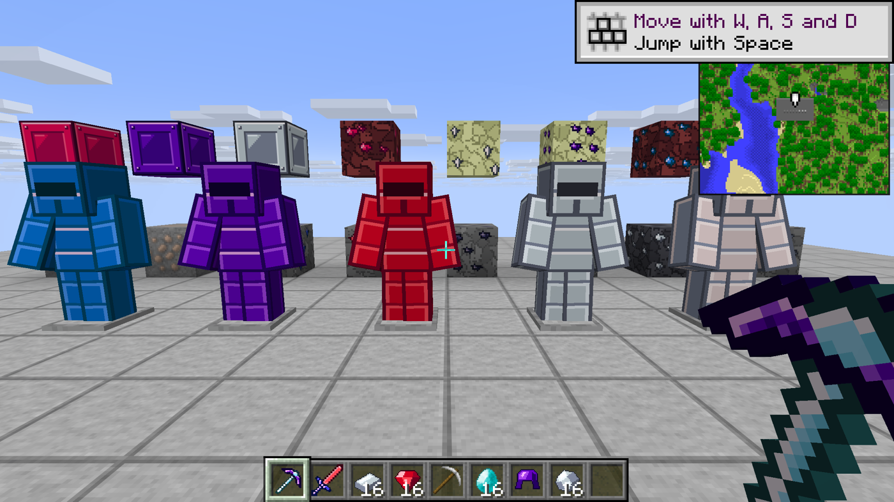
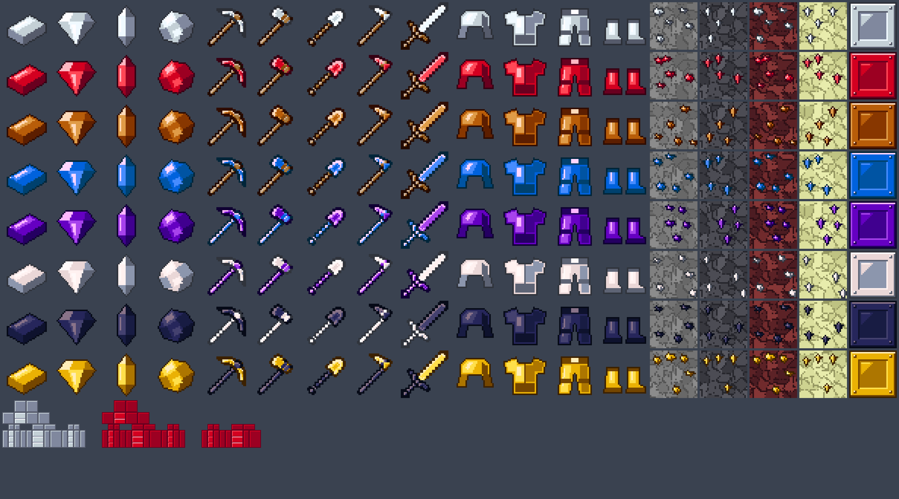

# Ore Overhaul Long Climb

A mod for [Horizon](https://github.com/horizon-rust/horizon) (Minecraft: Java Edition 26.3 rewritten in Rust) that stretches mining into 50 ore tiers. Every ore needs a pickaxe from the tier below it. Diamond sits at tier 20, and 30 more tiers go far past it, through the Nether and the End.

The goal is a very slow climb: around 70 hours to reach diamond gear. That number is a target and hasn't been measured yet.



**Status: alpha.** Don't expect it to be balanced.

| In this version | Not yet |
|---|---|
| Ore tiers 1 to 50, each with its ladder ore plus 1 to 4 more: 188 ores in all, in the Overworld, Nether and End | Pacing towards 70 hours (unmeasured) |
| Tools and armor for every tier, hammers and excavators (3x3), and an AIOT per tier | Chest loot and villager trades still let you skip tiers |
| A 5x5 crafting table: everything past the stone pickaxe needs it and 2 to 3 times the material, in the recipe's own shape | Tougher mobs (planned to stay slight) |
| A manual (press B), a 24-hour clock under the minimap | |
| Mining Tooltips: durability and mining level on every tool and ore | |

[The full tier table](docs/tiers.md) lists each ore, where it generates and its stats. Stone counts as tier 1: a wooden pickaxe mines it, and a stone pickaxe mines tier 2. Wood is the starting tool.



## Install

You need Horizon's Nightly from 2026-11-04 or newer.

1. Download from [Releases](https://github.com/kodasdream/ore-overhaul-long-climb/releases): `longclimb-0.5.0.hmod`, `longclimb-0.5.0.hnmod` and, if you want the tooltips, `miningtips-1.1.0.hnmod`.
2. Put the `.hmod` in `horizon-mods/` and the `.hnmod` files in `horizon-native-mods/`, inside your game folder (the one holding `options.txt`).
3. Build the game with them. Native mods run with full access to your computer, so read their source (it's in this repo, and inside each `.hnmod`) before you trust them:

```bash
horizon-launcher native-build --ignore-pins --trust-native-code
```

4. In the game, open **Options → Mods** and turn them on, then restart and create a **new world**. Ores only change in newly generated terrain.

The `.hmod` alone gives you the ores, tiers, items and recipes, but not the 5x5 table, the 3x3 hammers, the manual or the clock: those need `longclimb-0.5.0.hnmod`.

Horizon's docs say mods work on LAN and dedicated servers when everyone has the same version. I haven't tested that with this mod yet.

## What's where

- `mod/longclimb`: the content mod, as generated.
- `native/longclimb`: the 5x5 table, the recipe rewrite, hammers and excavators, AIOT right clicks, the manual and the clock.
- `native/miningtips`: Mining Tooltips, a separate mod.
- `tools/generator`: writes `mod/` from one table (`design.py`). `tools/pack/aoo_private.py` builds a personal resource pack from your own copy of The Age of Ores (see NOTICE).
- `tests/`: the scripts that drive a real game to check mining levels, crafting and worldgen.

## Extended Classic Tinkers

Tinkers' Construct 1.12 for Horizon, built on this mod's tiers, lives in its own repo: [Extended Classic Tinkers for Horizon](https://github.com/kodasdream/extended-classic-tinkers-horizon).

## The modpack

This is the set of mods I play it with. Long Climb doesn't need any of them.

| Mod | Version | Where to get it |
|---|---|---|
| JEI for Horizon | 0.1.0 | Horizon's mod list, or the zip below |
| LookAt | 0.2.1 | Horizon's mod list, or the zip below |
| Mod Menu | 0.3.3 | [Its v1.5 release](https://github.com/tariksabanuz/ModMenuHorizon/releases/tag/v1.5), or the zip below |
| ShulkerPeek | 0.1.0, patched | The zip below |
| SmartF3 | 0.1.0, patched | The zip below |
| Classic Zoom | 2.0.0 | Horizon's mod list |
| Minimap | 2.0.0 | Horizon's mod list |
| Wisdom Shaders V3 | 1.1.0 | Horizon's mod list |

The five mods in `modpack-native-mods-0.2.0.zip` (on the 0.2.0 release) go in `horizon-native-mods/`, and then the launcher builds the game with them:

```bash
horizon-launcher native-build --ignore-pins --trust-native-code
```

Native mods run with full access to your computer, so only build ones you trust. Their source is readable inside each `.hnmod`.

**Why the patches and `--ignore-pins`?** Some of these mods are pinned to older Horizon commits, and the launcher builds your whole game on a mod's pinned commit. If that's from before 2026-10-31 14:22 UTC, single-player worlds lose your position, inventory and XP on Save and Quit, because [the fix](https://github.com/horizon-rust/horizon/pull/5092) came later. Older builds also refuse this mod and Wisdom Shaders. The Mod Menu listed on Horizon's mod list (0.3.0) doesn't compile on this Nightly, so use 0.3.3.

ShulkerPeek and SmartF3 needed small changes to compile on the 2026-11-04 Nightly, in [`modpack/patches/`](modpack/patches). SmartF3's F3 screen no longer names a LAN player under the crosshair. All credit for these mods goes to their authors.

This repo has no texture pack, because a 32x32 pack would contain Mojang's art.

## Tests

`tests/run_tests.py` starts real Horizon in a scratch folder and checks 29 things, 21 of them whether a given pickaxe can mine a given ore, the rest armor, crafting and ore generation. All 29 pass on the 2026-11-04 Nightly, with Long Climb on its own or with the modpack. `tests/save_test.py` checks that a world keeps its progress after Save and Quit. They run on Windows through WSL, and you'll need to set your own Windows paths.

## Building from source

`mod/longclimb/` is the mod's source: JSON and PNG files, which zip into the `.hmod`. They're generated by `tools/generator/gen.py` from the table in `design.py`. Regenerating needs a local copy of the DD&SS 1.12.2 modpack and a dump of its Tinkers registry, made with `tools/ddss-dump/`.

## Credits and licence

MIT, see [LICENSE](LICENSE). Tool textures start from Tinkers' Construct by SlimeKnights (MIT). See [NOTICE.md](NOTICE.md) for all credits.

Unofficial. Not affiliated with Mojang, Microsoft, the Horizon project or SlimeKnights. You need your own copy of Minecraft: Java Edition.
